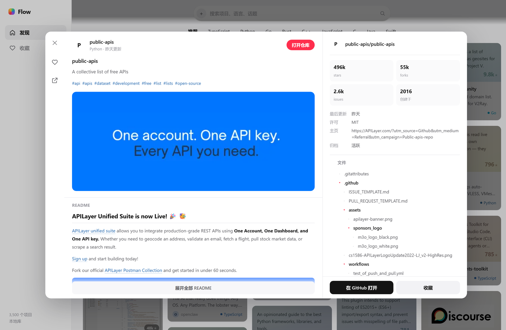
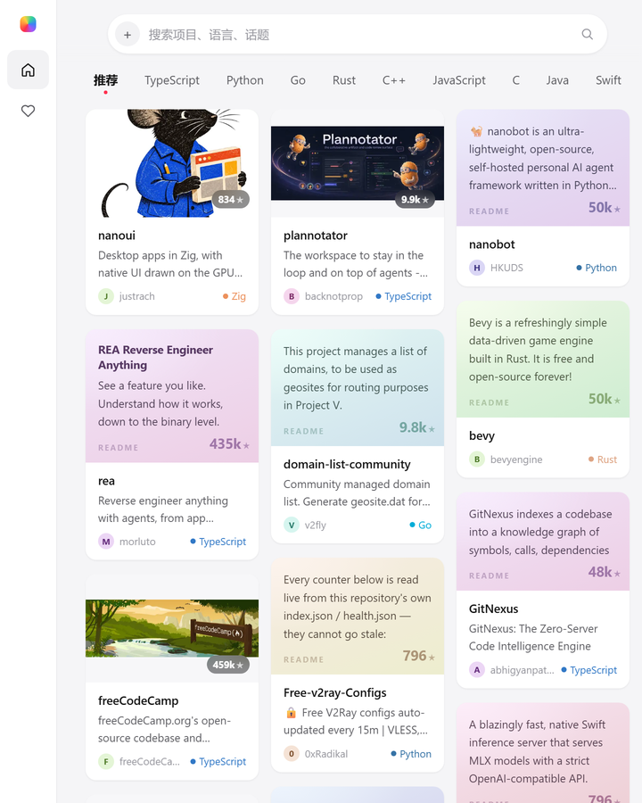

# Flow

**信息流式的 GitHub** —— 帮你发现可能感兴趣的项目，而不是把排行榜再抄一遍。

3500 个真实项目随程序一起分发，双击就能刷：不用登录、不用联网、不用等采集。
卡片头部就是 README 首屏，点开能读完整个 README 和文件树。


*1440 宽排五列。图上每个项目、每张封面、每段摘录都来自真实数据，不是占位图。*

## 为什么不是又一个排行榜

按星数排出来的首页永远是同一批巨无霸，那是榜单不是发现。
所以这里做的是「流」：卡片有图有文、可以一直往下翻，筛选交给语言分类和搜索，
排序交给一个会说人话的打分函数（见下文）。

库里只有大约三分之一的项目有 README 配图，所以「没有图」是常态而不是异常。
没有图的项目会被排成一段被截断的 README：标题加首段，底下留一行极小的
`README` 标明出处。两种形态长得像同一张卡片，扫过去不会一列全是色块。

## 点开一张卡片



*左栏三个操作，中栏是内容本身，右栏是数据和文件树；背景是变暗的信息流，不是另一个页面。*

中栏从上到下：作者 → 项目名 → 一句话简介 → 话题标签 → 封面大图 → **README 正文**。
README 是现拉的，用自己写的 markdown 渲染器排版，标题、表格、代码块、引用、
清单和图片都能出来；长到离谱的 README 默认只展开一屏多，底部渐隐，
点「展开全部 README」才铺开（`public-apis` 那份渲染出来是 14 万像素，约 190 屏）。

右栏是 stars / forks / issues / 创建年份、最后更新、许可、主页，
最下面是**文件树**：按路径层级缩进，目录在前，超过 90 条会写明还剩多少。

## 窄窗口



*720 宽：左侧导航收成底部一条，瀑布流降到三列，卡片内容不变形。*

窗口小于 460 是两列，小于 680 三列，小于 1000 四列，否则五列。列宽按容器实测算，
不是写死的百分比——写成百分比在 1180 那种半宽窗口里会挤出一列 165px 的碎条。

## 跑起来

```bash
cargo build --release -p flow-app
```

产物是**两个文件，必须放在同一目录**：

```
target/release/flow.exe
target/release/seed.db      # 首次启动时复制到 %APPDATA%\flow\flow.db
```

双击 `flow.exe`。之后所有读写都在 `%APPDATA%\flow\flow.db`，不再碰 `seed.db`。

不启动窗口验证数据链路：

```bash
FLOW_SELFTEST="C:\path\selftest.json" ./target/release/flow.exe
```

它会跑一次真实取数 + 一次收藏写入往返，把结果写成 JSON 后退出。**不开窗口**，
用来确认 exe 到底连没连上库——上一版就是死在这里，界面一切正常，实际四天没读到一条真项目。

## 结构

```
core/                所有逻辑，与界面无关
  src/model.rs       领域类型，扁平：一行 SQLite ↔ 一个结构体 ↔ 一张卡片
  src/store.rs       存储 + 排序取材（含分档轮转）+ 老库补列
  src/rank.rs        打分，纯函数，有单测
  src/readme.rs      从 README 原文里抽首屏（标题 / 首段 / 首图）
  src/image.rs       只从文件头读图片宽高，不引编解码器
  src/source.rs      唯一的出网口：搜索、限速、README、目录树、图片探测
  src/bin/flowctl.rs 开发期命令行
app/                 桌面外壳：只算数据目录、落种子库、转发命令
  src/main.rs        没有任何业务逻辑，也没有一句 SQL
  seed.db            随包发布的 3500 条种子库
web/                 界面：原生 ESM + CSS，无框架、无构建
```

界面是纯静态文件，进度条、瀑布流、详情浮层、markdown 渲染全在 `web/` 里，
没有构建步骤，改完刷新就见效。

## 三条不能破的规矩

1. **只有一条数据通路**。界面拿到的项目一定来自 `core/store.rs`。拿不到就报错并在
   界面上显示，**永远不返回假数据**。上一版有个「连不上就退回 24 条演示数据」的分支，
   界面看着一切正常，实际四天没显示过一条真项目 —— 这是它死掉的直接原因。
2. **核心层不碰平台路径**。`core/` 里出现 `APPDATA` / `HOME` 就是错的。数据目录由外壳
   传进来，否则搬到安卓上第一个崩的就是这里。
3. **打分是纯函数**。同样输入必须给同样分数，否则没法测、也没法解释「为什么推这个」。

## 打分怎么算

```
score = 0.45 × 热度 + 0.55 × 新鲜度
```

- 热度 = `log10(stars+1)/6`。除以 6 而不是 5，是为了让 10 万星只到 0.83，
  否则 pytorch 和万星项目同分，排序退化成按星数排队。
- 新鲜度 = 指数衰减，半衰期 45 天。
- 硬排除：fork、归档、无描述、星数 < 30。
- 半年没推送 ×0.6；描述短于 12 字 ×0.7。

取材时按星数分四档（<1k / 1k–10k / 10k–50k / >50k）轮转，同作者不相邻。

## 卡片头图为什么读 README

信息流第一屏决定用户要不要点进去。只放色块加首字母，扫过去全是一个形状，什么也看不出来；
直接拿 GitHub 的 `og:image` 又是「卡中卡」——一张卡片里套一张带边框的卡片，而且那张图
本身就是头像 + 简介 + 星数的排版，跟我们的卡片内容重复。

真正的信号在 README 里：作者自己写的第一句话，和第一张截图。所以采集期就把每个仓库的
README 拉一次，抽三样东西存进库：

- **一级标题**，且只在它比项目名多说点什么时才显示（`Learn Rust, one exercise at a time`
  值得显示，`nanobot` 就是重复）；
- **第一段正经说明**，跳过徽章行、代码块、HTML、语言切换条、ASCII art 和纯链接行；
- **第一张能当封面的图**，跳过徽章站、SVG、视频附件，并且真的取回文件头看宽高——
  小于 320×160 或比例极端（太扁的横幅、太长的长图）一律不要。

3500 个仓库就是 3500 次 API 请求，按 1.3 次/秒（令牌额度 5000 次/小时）排队，
四十多分钟跑完，只在造种子库时做一次。刷信息流时不发任何请求，读的只是这三列；
只有点开某张卡片，才会去拉那个仓库的 README 全文和目录树。

## 采集为什么按星数分档

Search API 按 `sort=stars` 取第一页，永远返回该语言星数最高的 100 个。
条件写得再宽（`stars:>=50`），捞回来的还是同一批人尽人皆知的仓库，中小项目一条都进不来。
所以查询被切成三个区间（100–800 按更新时间、800–10000、≥10000），一档一档地要。

## 开发期工具

采集与检查都在 `flowctl` 里，产品运行时不需要它：

```bash
export FLOW_GH_TOKEN=<你的令牌>

./target/release/flowctl harvest --db build/seed.db --target 3500   # 采集，约 5 分钟
./target/release/flowctl enrich  --db build/seed.db                 # 补 README 首屏
./target/release/flowctl enrich  --db build/seed.db --redo          # 改了抽取规则重跑
./target/release/flowctl readme  --repo tauri-apps/tauri            # 看单个仓库抽出了什么
./target/release/flowctl stats   --db build/seed.db                 # 看分布与前十条
./target/release/flowctl export  --db build/seed.db --out build/feed.json
```

把采集结果做成随包发布的种子库：

```bash
sqlite3 build/seed.db "PRAGMA wal_checkpoint(TRUNCATE); VACUUM INTO 'app/seed.db';"
```

## 环境

Windows + **MSVC** 工具链（Tauri 官方只支持 MSVC，gnu 下链接出来的程序会在加载阶段就失败）：

```bash
winget install --id Microsoft.VisualStudio.2022.BuildTools --override "--quiet --wait --add Microsoft.VisualStudio.Workload.VCTools --includeRecommended"
rustup toolchain install stable-x86_64-pc-windows-msvc --profile minimal
cargo +stable-x86_64-pc-windows-msvc build --release -p flow-app
```

运行时不登录、也不需要令牌；只有 `flowctl harvest` / `enrich` 采集时需要 `FLOW_GH_TOKEN`。

## 踩过的两个坑

**1. 不要把种子库 `include_bytes!` 打进 exe。**
试过，结果是 4.9MB 的未签名程序里塞着 1.5MB 二进制数据——Defender 判成加壳文件，
编译出来几秒就被删，双击也起不来（`CreateProcess` 返回 WinError 2）。
改成从 exe 同目录读 `seed.db` 之后立刻正常。

**2. 分发目录不要放进带实时扫描的路径。**
未签名的 exe 一旦被复制出构建目录，可能几秒内就被清掉。开发时从 `target/release/` 直接跑最稳。

## 还没做

- 登录与个性化画像（GitHub OAuth 只在设计阶段定过方案，没有代码）
- 多设备同步
- APK（技术路线已定 Tauri 2，工具链未装）
- 增量采集（现在只有 `flowctl harvest` 手动跑）
- **封面图完全离线**：图片现在是 `raw.githubusercontent.com` 的外链，断网时全部退回文字形态。
  把缩略图压好一起打包（估计 +20MB）还没做。

## 许可

[MIT](LICENSE)。挑几条 issue、提 PR 都欢迎。
