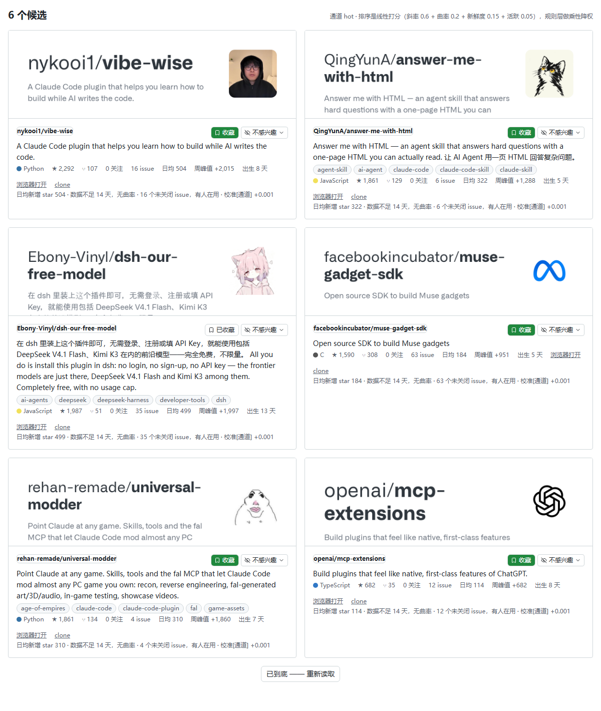
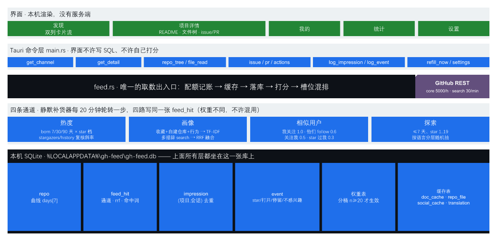

# GitHub Flow

本地优先的 GitHub 项目发现器。不是 GitHub 客户端——它只解决一件事：**帮你决定要不要深入看某个项目**。

（界面显示名是 **GitHub Flow**；包名、crate、数据目录 `%LOCALAPPDATA%\gh-feed\` 仍是 `gh-feed`，
改它们会把已经攒下的库和凭据文件孤立掉，要改得单独做一次迁移。）

状态：**可运行的桌面原型**（Windows / Tauri 2）。窗口能开、数据是真的、排序会随你的行为变化。未发布、未签名。



## 它跟 "trending 列表" 的区别

GitHub 没有 trending 接口，官方页面的排序也是黑盒。所以这里把两件事拆开：

- **测量**有官方接口：`GET /repos/{owner}/{repo}/stargazers/history` 一次请求拿到一个项目从出生到今天的**每周新增 star 曲线**。实测各周之和与 `stargazers_count` 自洽（差 1，即未满的当天）。
- **发现**没有官方接口，只能自己造候选：限定出生窗口后，"累计 star" 就等于"这段时间涨的 star"，于是 `created:>N天 + sort=stars` 本身就是增速榜。

热度可以问 GitHub，名单必须自己造——整个架构由此展开。

## 功能

| 页面 | 有什么 | 都在应用里 |
|---|---|---|
| **发现** | 双列卡片流，卡顶是 GitHub 自己的 OG 预览图；整张卡可点进详情；中文简介（可选）、topics、语言点、★/⑂/关注/issue、日均新增 star、周峰值、出生天数、推荐理由 | 收藏、不感兴趣（要选理由）、浏览器打开、`git clone` 复制到剪贴板 |
| **项目详情** | README（GitHub 官方渲染的 HTML）、右栏**文件树**（`git/trees?recursive=1` 一次拿全）、点文件看内容、star 增长曲线、语言构成、最近 release | 点 `.md` 给官方渲染版，可切回带行号的源码；README 里的相对链接、目录锚点、指向别的 md 的链接**都在应用内跳**，不出窗口 |
| **Issues / PR** | 列表带计数，点开看正文、评论（含作者身份徽章）、PR 的改动量与逐文件 diff | 全部走 REST + `html+json` 媒体类型，不打开浏览器；Actions 列表也在应用内 |
| **我的** | GitHub 侧公开信息（头像、仓库、近 90 天事件）、**它以为你喜欢什么**（词表与语言权重）、**你做过什么**（行为流） | — |
| **统计** | 曝光/点开/收藏/不感兴趣、四档通道各多少条、池子总量、**静默补货**最近五步的真实请求数、**校准就绪度**（每个桶的 n 与权重） | — |
| **设置** | 主题集、翻译开关、后台补货开关、账号与凭据（设备码登录 / PAT） | — |

**明确没做的三块**（GitHub 仓库页上有，但这台应用给不了，导航里干脆不放）：
Projects（新版只有 GraphQL 能给，REST 的 `/projects` 已下线，实测 404）、Security（代码扫描/依赖告警要仓库读写权限）、Insights（流量与贡献者要 push 权限）。

## 架构



一句话：**界面点一下 → Tauri 命令 → `feed.rs` 唯一的取数出入口 → GitHub REST → 落到本机一张 SQLite**。
所有 HTTP、配额记账、缓存、落库、打分都只走 `feed.rs` 这一处；界面不许写 SQL、不许自己排序打分。

## 推荐算法细节

**MVP 不用任何大模型**，全部是可解释的统计量，每条理由都印在卡片上。

### 1. 打分（`feed.rs` `load_feed`）

```
base   = 0.60 · log10(slope + 1) / 4        # slope = 日均新增 star；没测到曲线 → 0 且整体 ×0.75
       + (曲率 > 1.2 ? +0.20 : 曲率 < 0.7 ? −0.15 : 0)
       + 0.15 · (1 − min(出生天数, 90) / 90)  # 新鲜度
       + (未关闭 issue > 0 ? +0.05 : 0)       # 有人在用
通道加成 = min(rrf × 0.5, 0.35)               # 画像/相似用户命中；social 的 rrf 先 ×1.4
最终分   = base × 分桶权重 × (spam ? 0.4 : 1)
```

两条硬规矩：

- **曲率对出生不满 14 天的项目必须是 `null`**，不许用 0 顶替——否则"没有历史"会被读成"增长平稳"，把新秀全打死。界面上如实显示"数据不足 N 天"。
- 没测到增速曲线**不等于零分**，但要乘 0.75：未知不是罪，也不该白拿热度分。

### 2. 四条通道（候选从哪来）

| 通道 | 来源 | 关键常数 |
|---|---|---|
| **热度** | `created:>7/30/90 天 + sort=stars`，再用 `stargazers/history` 复核斜率与曲率 | 每档 star 区间分别查，避免 1000 条上限截断 |
| **画像** | 你的收藏 + 你自己建的仓库（×1.2）+ 本机行为（star/打开/停留，按 `exp(−age/30)` 衰减）→ TF-IDF 加权词表 → 生成多措辞 search → **RRF 融合** | `rrf += w/(60+rank)`；同一意图换措辞，前 20 名只重合 1/20，所以融合是正确性要求不是优化 |
| **相似用户** | 以**你关注的人**为主源：我关注 1.0、他们 follow 的人 0.6、关注我的人 0.5、star 过你仓库的人 0.3 → 抓这些人的最近收藏 | 45 天没动静的源直接跳过；条目按 `exp(−age/90)` 加权；一年前的收藏丢掉 |
| **探索** | 出生 ≤7 天、star 1..19 的新生池，按语言分层随机抽 | 作用是破兴趣气泡，样本量小，不参与"准不准"的评价 |

> 曾经想用"谁 star 了同一个仓库"做行为共现，实测**这条路被 GitHub 关了**：`/repos/{o}/{r}/stargazers` 与 `/subscribers` 只对仓库管理员开放（别人的仓库返回 404），所以相似用户只能走 follow 图。

### 3. 规则层（乘性降权，不是加分）

```sql
stars > 5000 AND open_issues = 0                 -- 五千 star 一个 issue 没有
stars > 5000 AND watchers/stars < 0.005          -- 只被刷 star 不被订阅
archived = 1                                     -- 已归档
stars > 300  AND forks/stars < 0.005             -- 没人 fork 的热度
stars > 300  AND size_kb < 60 AND forks < 5      -- 空壳仓库
```

每条都带 star 门槛——新项目 watcher 普遍为 0，不加门槛会把整个新秀通道判成刷量。

### 4. 槽位混排（为什么不能只按总分排）

hot 的候选天生有斜率（基础分 0.4~0.6），画像与相似用户的候选大多没有（基础分 0，只有那一档 `min(rrf×0.5, 0.35)` 加成）。放同一把尺子上量，实测 **1923 条 social + 587 条 profile 全被压在 hot 下面，前 6 名清一色 hot**。所以每 20 个槽位按固定配比取：

```
热 11 / 画像 4 / 相似用户 3 / 探索 2
```

某条通道没货就让位给热榜，全空就让给任意还有货的——不能因为配额没填满就少给用户内容。
**被规则降权的项不许占用画像/相似/探索这三个推荐位**（它们总是分数最高的一批，一插就把三个通道全占了）；它们仍留在池子里，由 hot 桶按分数自然排。最后再做一次打散：同一 owner 不连续出现两次。

### 5. 反馈与校准

- **曝光**：卡片进入视口 ≥50% 且停留 ≥1 秒才算一次，按 `(项目, 会话)` 去重。把"没看到"记成"不喜欢"，学出来的权重会系统性打死排得靠后的那类项目。
- **正样本**：应用内收藏、点开、停留时长、复制 clone；**负样本**：不感兴趣 + 理由（太老/不是我要的语言/像营销号/已知道）。
- **分桶校准**：桶 = 语言 / 出生窗口 / 命中词数档 / spam；`w = clamp(桶内命中率 / 全局命中率, 0.5, 2.0)`，**样本 n < 20 的桶权重强制 1.0**。统计页把每个桶的 n 和是否生效直接列出来——几十条数据就改排序等于把噪声当信号。

### 6. 静默补货（保证你永远有内容可看）

抓取不是"点一下按钮跑一轮"，而是后台悄悄把池子养大、界面一次只展示一页：

- 启动 25 秒后连做 2 步，之后**每 20 分钟一步**（设置里有关闭开关）；
- 每步只轮转**一条**通道（画像 → 热度 → 探索 → 相似用户），并给榜上前 6 名补测增长曲线；
- **剩余配额 core < 200 时整步跳过**，绝不为抢内容把额度打空；
- 一页 100 条，池子实测从 1543 养到 4700+；统计页能看到最近五步各用了多少次请求、新增多少条。
- 发现页右上有个**「刷新」**：它就是手动触发这一步补货、然后重读本屏，并把"通道 / 新增几条 / 请求 core 几次 search 几次 / 池子前后"回显成一句话。
  故意不做成"只重读本机库"——榜的顺序是固定槽位算出来的，池子没变时点了跟没点一样；也不复用顶栏的「采集」，那一次要 60~90 个请求，刷新不该顺手花掉那么多额度。
  配额不足时这一步会自己跳过，界面会明说"没补货，只重读了本机已有的内容"。

## 已实测的关键事实

- 未登录配额：core 60/h、search 10/min、**GraphQL 0**；认证态 core 5000/h（`/rate_limit` 实测，注意这个端点本身是缓存的，不能用来做前后差值记账）
- search 每个查询**最多翻到 1000 条**（`page=11` → 422）；非法 `sort` 值被静默忽略
- 近 7 天出生且涨到 20+ star 的项目，全 GitHub 只有 **526 个** → 热度层不需要切网格；探索层（star 1..19）超了 63 倍，必须按语言切
- GitHub search 是词面 AND：同一意图换措辞，前 20 名结果只重合 **1/20** → 匹配必须在本地做，search 只当进料口
- 新项目 72% 没有 topics、16% 没有简介、简介平均 101 字符；`in:readme` 会炸出 10 万条垃圾
- 新项目的 `stargazers/history` 只有 1 个周桶 → 斜率要用桶内的 `days[7]` 每日数组算
- `/repos/{o}/{r}/stargazers`、`/subscribers` **锁给仓库管理员**（别人的仓库 404）；`/forks`、`/users/{login}/starred` 匿名可读
- `contents/{path}` 带 `Accept: application/vnd.github.html+json` 会返回**官方渲染好的 HTML** → 任意 md 文件都能在应用里渲染，前端不用引 markdown 库
- API 渲染的 README **保留相对图片路径**，不处理会被解析成 `tauri.localhost/...` 并返回 200 假成功；而且渲染出来的 `<h1>~<h6>` **不带 id**，目录锚点得自己补
- 内嵌 WebView 加载 github.com 返回 200（`frame-ancestors 'none'` 只约束被嵌入，不约束顶层文档；**iframe 方案永久不可行**）

## 为什么是本地优先

行为日志只留本机，**没有服务端，也不回传**。代价很明确：达不到流媒体那种"懂所有人"的精准，因为群体协同过滤需要跨用户数据。换来的是：不需要账号系统、不需要服务器、隐私承诺是真的。

对外只有两类请求：**GitHub 自己的域名**（API 与 OG 卡图，后者不占 API 额度），以及**开启翻译后**被翻译的简介会发给第三方翻译服务（默认关闭，设置页写明）。

## 目录

```
web/                 界面：React 19 + Vite 8 + Tailwind v4
  src/App.tsx        三栏工作台外壳（Soda 的 FileManagerPage）
  src/views/         FeedView（卡片流）/ DetailView / ItemDetail / ActionsPanel / MeView / StatsView / SettingsView
  src/components/    RepoCard（卡片+OG 图）/ RepoTree（文件树+预览）/ RichHtml（第三方 HTML 的唯一出口）/ gh.tsx（GitHub 词汇）
  src/lib/bridge.ts  与 Rust 命令的类型契约；界面不碰 SQL
  check-skin.mjs     三层验收里的静态层：源码 + 产物 CSS 断言，--live 会真打 GitHub
soda/                Soda UI 源码：ui（组件箱）+ theme（token 真源）
package.json         pnpm workspace 根（web + soda/*）
src-tauri/
  src/feed.rs        取数、配额记账、落库、斜率、规则、打分、槽位、补货（唯一出入口）
  src/main.rs        Tauri 命令层 + 后台补货线程
  src/bin/collect.rs CLI：采集 / 画像 / 探索 / 详情 / 树 / 文件 / issue / PR / diff / Actions / 校准 / 补货 / 翻译 / 改写
docs/                推送子系统技术手册 v0.1.3 + 配图
measurements/        上面那些"已实测事实"的原始响应与复跑脚本
tools/               WebView2 承载探针（.NET，用于在不装 MSVC 的情况下验证内嵌浏览）
```

界面用 Soda UI 的**组件箱与 token 层**（`bg-card` / `text-muted-foreground` / `gap-md`，出现色阶数字或散装像素即越界），默认主题集是 `github`（Primer 的色值 + 6px 圆角 + 无阴影）。README 那种第三方 HTML 在 `styles.css` 的 `.md` 段里按同一套 token 手写。

## 复跑验收

```bash
corepack pnpm@10 install
corepack pnpm@10 --filter web typecheck
corepack pnpm@10 --filter web build
node web/check-skin.mjs            # 静态层：57 条（token/默认集/逐页信息块/跨语言的取数契约）
node web/check-skin.mjs --live     # 行为层：76 条（真打 GitHub：树、文件渲染版、issue 不混 PR、缓存命中、翻译、改写器）
```

第三层是 DOM 渲染探针（`web/probe.html`，mock 掉 Tauri 命令，用编造但形状正确的数据验前端）：

```bash
corepack pnpm@10 --filter web exec vite --port 1430
# 浏览器开 http://localhost:1430/probe.html —— 49 条断言直接画在页面上，标题 PROBE PASS/FAIL
```

## 配图是怎么来的

三张图都是**真数据**，不是设计稿：

```bash
# 卡片流与详情页：用本机库里的真实热榜（只取 hot 通道，并剔掉带个人口味的理由行）
node tools/mkshot.mjs && msedge --headless=old --window-size=1200,1420 \
  --virtual-time-budget=30000 --screenshot=docs/images/feed.png \
  "http://localhost:1430/probe.html?shot=feed"
```

架构图的可编辑源是 `docs/images/pipeline.fbd.json`（渲染出 `pipeline.svg`，README 里放的是它导出的 PNG，
因为 GitHub 对 README 内嵌 SVG 的处理不如位图稳）。

## 构建

Tauri 2 走 **GNU 工具链**（不需要 Visual Studio）。依赖 MinGW 在 PATH 里：

```bash
export PATH=/path/to/msys64/mingw64/bin:$PATH   # dlltool/windres 要能找到
corepack pnpm@10 install                        # 本机 pnpm 只能经 corepack
corepack pnpm@10 --filter web build             # 前端产物：web/dist（已 gitignore）
cd src-tauri && cargo build                     # 前端资源在编译期嵌进 exe
./target/debug/gh-feed.exe
```

改界面时用 `corepack pnpm@10 --filter web dev` 起 Vite（:1420）再配 `tauri dev` 才有热更新；
`cargo build` 出来的 exe 读的是构建那一刻的 `web/dist`，改完前端要重新 `cargo build`。
窗口 `minWidth` 定在 1024：Soda 的三栏骨架在 `lg` 以下按契约直接隐藏侧栏，没有做兜底抽屉。

采集器可以单独跑（不依赖界面）：

```bash
./target/debug/collect.exe 1 12          # 热度采集：每查询 1 页、补测 12 条曲线
./target/debug/collect.exe explore 3     # 探索池：每语言抽 3 个
./target/debug/collect.exe profile       # 建画像并检索
./target/debug/collect.exe refill        # 手动跑一步静默补货（看池子涨多少、真实请求几次）
./target/debug/collect.exe social 12     # 相似用户通道：取 12 个源
./target/debug/collect.exe top 12        # 榜上前 12 名，带通道与理由
./target/debug/collect.exe tree <id>     # 文件树；file <id> <路径> [html] 读文件（html = 官方渲染版）
./target/debug/collect.exe issue <id> 1  # 应用内 issue 详情；pr / comments / files / actions 同理
./target/debug/collect.exe rewrite       # 离线单元：README 相对路径改写器
./target/debug/collect.exe translate <文本...> [--url=坏主机]   # 翻译与"失败不污染缓存"
./target/debug/collect.exe calibrate     # 分桶校准（样本 <20 的桶不生效）
./target/debug/collect.exe api <路径> [accept] [落盘路径]        # 通用认证探针
```

数据与凭据都在 `%LOCALAPPDATA%\gh-feed\`（`gh-feed.db`、`accounts.json`、`ui.log`），**都不进仓库**。
`ui.log` 是界面自己写进去的：窗口一关就什么都没了，判成败看这份日志而不是看退出码。

## 还没做

- 场外收藏回收（手册 9.5：登录后轮询 `/user/starred`，把你在 GitHub 网页上点的 star 收回来当正样本）
- 收藏的组织结构（分类/标签/稍后看）
- 内容策略口径（破解工具、疑似营销号推不推——现在只靠规则层降权，没有明确政策）
- CSP（README 与 issue 正文是外部 HTML，目前只靠正则清洗，不是真隔离）
- 代码块语法着色（现在只有语言标注 + 等宽，要颜色得引一个高亮库）
- 凭据换成系统钥匙串（现在是本机单独文件）
- 代码签名与自动更新（双平台约 $400~600/年）
